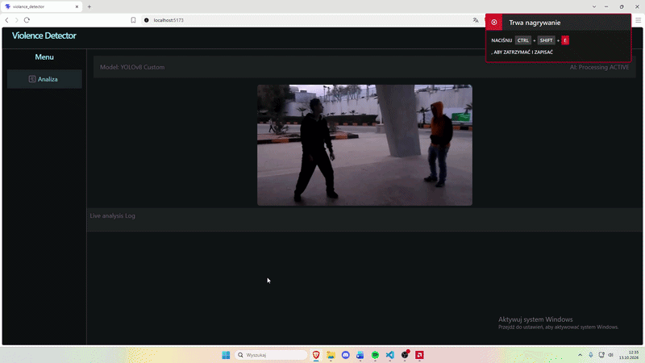

# 🛡️ Violence Detector

Aplikacja do wykrywania przemocy w czasie rzeczywistym na obrazie z kamery. Backend analizuje każdą klatkę wytrenowanym modelem **YOLOv8**, a frontend w React pokazuje podgląd z kamery i listę ostatnich wykryć.

---

## 🎬 Demo



---

## ✨ Funkcje

* **Podgląd na żywo**: obraz z kamery z ramkami wokół wykrytych obiektów (strumień MJPEG).
* **Detekcja przemocy**: własny model YOLOv8 analizuje każdą klatkę; brane są pod uwagę tylko wykrycia z pewnością ≥ 0.8.
* **Log wykryć na żywo**: każde wykrycie trafia do panelu z miniaturą klatki, etykietą, pewnością modelu, nazwą kamery i godziną.
* **Poziomy zagrożenia**: etykiety są oznaczane plakietkami `HIGH` (np. violence, fight), `MED` (intrusion) lub `INFO`.

---

## 🧱 Architektura

```
┌──────────────┐   GET /video_feed  (MJPEG)       ┌──────────────────────┐
│   Frontend   │ ◄─────────────────────────────── │       Backend        │
│ React + Vite │                                  │  FastAPI + OpenCV    │
│ :5173        │ ◄─────────────────────────────── │  + Ultralytics YOLO  │
└──────────────┘   GET /detections (SSE)          │  :8000               │
                                                  └──────────┬───────────┘
                                                             │
                                                        kamera (0)
```

### Backend ([backend/main.py](backend/main.py))

| Endpoint      | Typ odpowiedzi                         | Opis |
|---------------|----------------------------------------|------|
| `/video_feed` | `multipart/x-mixed-replace` (MJPEG)    | Strumień klatek z kamery z naniesionymi wynikami detekcji. |
| `/detections` | `text/event-stream` (Server-Sent Events) | Nowe wykrycia w formacie `{ "label", "conf", "image" }`, gdzie `image` to klatka JPEG w base64. |

Ostatnie 20 wykryć jest trzymane w kolejce w pamięci (`deque`). Kamera włącza się przy pierwszym połączeniu z `/video_feed` i zwalnia po zamknięciu strumienia.

### Frontend ([src/App.jsx](src/App.jsx))

Aplikacja w React 19 zbudowana na Vite. Wyświetla strumień `/video_feed` w znaczniku `` i nasłuchuje `/detections` przez `EventSource`. Pasek logu pokazuje tyle ostatnich wykryć, ile mieści się na szerokość ekranu. Ikony pochodzą z `lucide-react`.

---

## 🧠 Modele

W katalogu `backend/` znajdują się wagi:

| Plik                       | Opis |
|----------------------------|------|
| `best_medium_25epochs.pt`  | **Używany domyślnie.** YOLOv8 medium, 25 epok. Wykrywa przemoc, ale często się myli. |
| `best.pt`                  | YOLOv8 nano, 60 epok. Słabo wytrenowany. |
| `yolov8n.pt`               | Bazowy, wstępnie wytrenowany model YOLOv8n. |

> ⚠️ **Ograniczenia:** obecny model daje sporo fałszywych alarmów, np. potrafi uznać osobę siedzącą przed komputerem w niektórych pozycjach za „przemoc”. Lepsze wyniki dałby większy model (np. YOLOv8 large) trenowany przez więcej epok, ale to wymaga dużo czasu i zasobów.

Model zmienia się w `backend/main.py`, w linii `model = YOLO("...")`.

---

## 🛠️ Wymagania wstępne

* **Node.js** (wersja 18 lub nowsza) oraz `npm`
* **Python 3.12** lub nowszy
* **uv**: menedżer pakietów i środowisk dla Pythona
* **Kamera** podłączona do komputera (używane jest urządzenie o indeksie `0`)

---

## 📦 Jak uruchomić projekt (lokalnie)

Projekt składa się z dwóch części. Każdą uruchamiasz w **osobnym oknie terminala**, oba serwery muszą działać jednocześnie.

### 💻 Terminal 1: Backend (FastAPI)

```bash
# 1. Przejście do katalogu backendu
cd backend

# 2. Utworzenie środowiska wirtualnego .venv (tylko za pierwszym razem)
uv venv

# 3. Instalacja bibliotek (tylko za pierwszym razem)
uv pip install -r requirements.txt

# 4. Uruchomienie serwera w trybie deweloperskim
uv run fastapi dev main.py
```

Backend działa pod adresem http://127.0.0.1:8000, a dokumentacja API (Swagger) jest pod http://127.0.0.1:8000/docs.

### 🌐 Terminal 2: Frontend (React)

W głównym folderze projektu (tam, gdzie jest `package.json`):

```bash
# 1. Instalacja zależności (tylko za pierwszym razem)
npm install

# 2. Uruchomienie serwera deweloperskiego Vite
npm run dev
```

Następnie otwórz w przeglądarce adres wypisany przez Vite (domyślnie http://localhost:5173).

---

## 📁 Struktura projektu

```
violance_detector/
├── backend/
│   ├── main.py                   # Serwer FastAPI: kamera, detekcja YOLO, endpointy
│   ├── best_medium_25epochs.pt   # Wagi modelu (domyślne)
│   ├── best.pt                   # Wagi modelu (nano)
│   ├── yolov8n.pt                # Bazowy model YOLOv8n
│   ├── requirements.txt
│   └── pyproject.toml
├── src/
│   ├── App.jsx                   # Główny widok: podgląd kamery i log wykryć
│   ├── App.css
│   ├── main.jsx
│   └── index.css
├── public/
├── index.html
├── package.json
└── vite.config.js
```

---

## 🧰 Technologie

* **Backend:** Python, FastAPI, Uvicorn, OpenCV, Ultralytics YOLOv8, PyTorch
* **Frontend:** React 19, Vite, lucide-react
